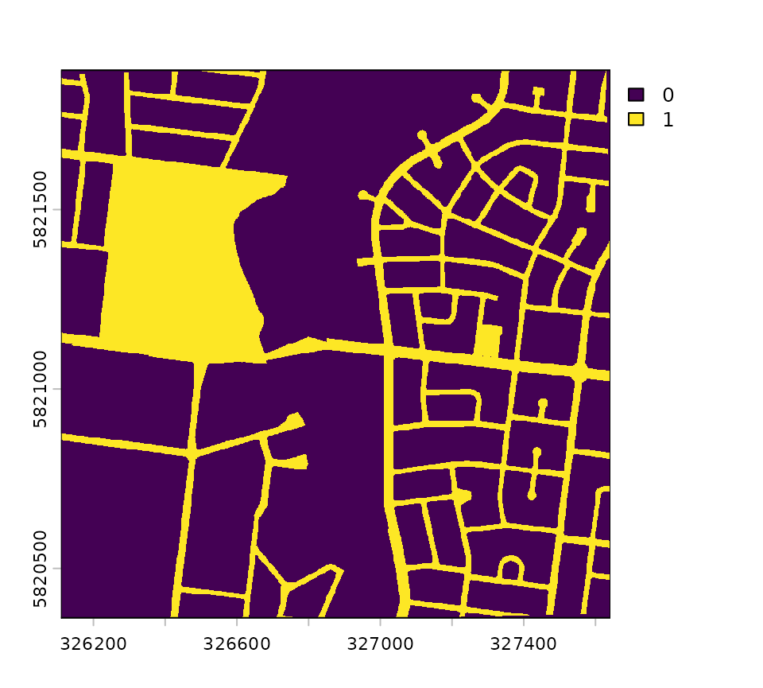
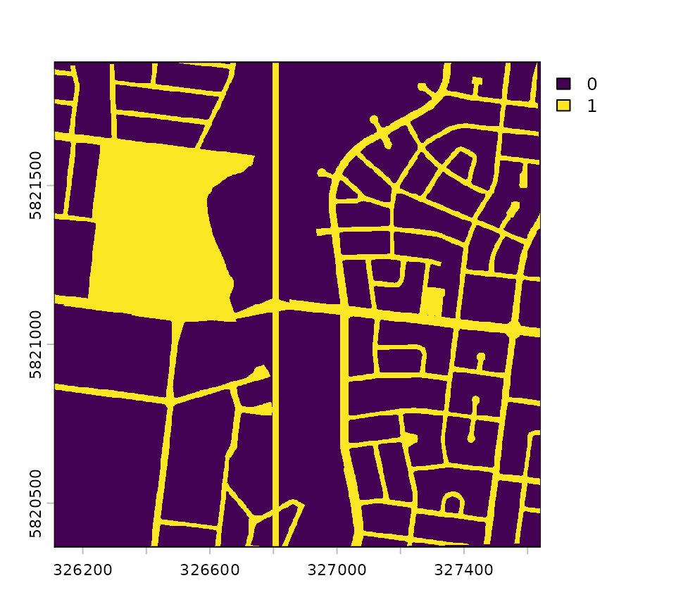

# Comparing scenarios

``` r

library(urbioconnect)
```

The [urbioconnect](https://urbio-ecology.r-universe.dev/urbioconnect) R
package implements [Kirk et al.’s
(2023)](https://doi.org/10.1016/j.mex.2022.101989) method for estimating
habitat connectivity in urban environments.

You can measure the connectivity with
[`habitat_connectivity()`](https://urbio-ecology.github.io/urbioconnect/reference/habitat_connectivity.md):

``` r

lizard_connectivity <- habitat_connectivity(
  habitat = example_habitat(),
  barrier = example_barrier(),
  interpatch_distance = 100,
  species = "Blue-tongued Lizard"
)
#> i Creating barrier mask
#> v Creating barrier mask [2.2s]
#> 
#> i Removing habitat underneath barrier
#> v Removing habitat underneath barrier [91ms]
#> 
#> i Buffering habitat for an interpatch distance of 100m
#> v Buffering habitat for an interpatch distance of 100m [6.5s]
#> 
#> i Fragmenting habitat layer along barrier intersection
#> v Fragmenting habitat layer along barrier intersection [28ms]
#> 
#> i Assigning patches ID to fragments
#> v Assigning patches ID to fragments [522ms]
#> 
#> i Summarising area in each patch
#> v Summarising area in each patch [162ms]
#> 

lizard_connectivity
#> # A tibble: 1 x 9
#>   species     interpatch_distance n_patches effective_mesh_ha prob_connectedness
#>   <chr>                     <dbl>     <int>             <dbl>              <dbl>
#> 1 Blue-tongu~                 100        59              4.49              0.171
#> # i 4 more variables: patch_area_mean <dbl>, patch_area_total_ha <dbl>,
#> #   data_resolution <chr>, patch_size <list>
```

This tells us what the baseline level of connectivity is.

A key addition Kirk et al. brought is in comparing a baseline level of
connectivity to a “scenario”. This is where, say, you compare the
baseline connectivity, to where the habitat is reduced, or grown, or
more barriers are added, or removed. This is very useful when designing
new urban spaces, as it allows planners to assess the ecological impact
a new plan can have on an urban area.

The goal of this vignette is to take a scenario that changes the
habitat, the barriers, or both, and then compare its connectivity to the
baseline.

## The data

We use the Blue Tongue Lizard example data:

``` r

layers <- prepare_rasters(
  example_habitat(),
  example_barrier(),
  data_resolution = 10
)
habitat <- layers$habitat_raster
barrier <- layers$barrier_raster
```

[`prepare_rasters()`](https://urbio-ecology.github.io/urbioconnect/reference/prepare_rasters.md)
puts both layers on a grid of 10 m cells, which keeps every comparison
here quick - since by default they are 2 m.

The scenario is a new road.
[`example_barrier_scenario()`](https://urbio-ecology.github.io/urbioconnect/reference/example-lizard-data.md)
is the lizard barrier layer with a road cut through it from north to
south.

``` r

library(terra)
#> terra 1.9.50
example_barrier() |> plot()
```



``` r

example_barrier_scenario() |> plot()
```



It comes on the original 2 m grid, so
[`onto_grid()`](https://urbio-ecology.github.io/urbioconnect/reference/onto_grid.md)
puts it on the baseline’s grid.

[A misaligned grid](#a-misaligned-grid) shows what happens if you don’t.

``` r

new_road <- onto_grid(
  layer = example_barrier_scenario(),
  grid = barrier,
  background = 0
)
```

In these maps, habitat is dark green and barriers are white:


## habitat connectivity comparison and scenarios

Two functions start from layers:

- [`habitat_connectivity_comparison()`](https://urbio-ecology.github.io/urbioconnect/reference/habitat_connectivity_comparison.md)
  compares one scenario with the baseline.
- [`habitat_connectivity_scenarios()`](https://urbio-ecology.github.io/urbioconnect/reference/habitat_connectivity_scenarios.md)
  compares several scenarios with the baseline.

Both run
[`habitat_connectivity()`](https://urbio-ecology.github.io/urbioconnect/reference/habitat_connectivity.md)
on the baseline and on each scenario, then compare the results.

If you’ve already run
[`habitat_connectivity()`](https://urbio-ecology.github.io/urbioconnect/reference/habitat_connectivity.md)
on each landscape yourself, you can use
[`compare_connectivity()`](https://urbio-ecology.github.io/urbioconnect/reference/compare_connectivity.md)
and
[`compare_scenarios()`](https://urbio-ecology.github.io/urbioconnect/reference/compare_scenarios.md),
to do just the comparing.

You give the baseline as `habitat_baseline` and `barrier_baseline`, and
the scenario as the layers the plan changes.

The function takes the rest from the baseline:

| You provide        | Scenario’s habitat | Scenario’s barrier |
|--------------------|--------------------|--------------------|
| `habitat_scenario` | `habitat_scenario` | `barrier_baseline` |
| `barrier_scenario` | `habitat_baseline` | `barrier_scenario` |
| both               | `habitat_scenario` | `barrier_scenario` |

Each layer you give is the whole layer after the change, not just the
part that changes. [What gives a misleading
answer](#what-gives-a-misleading-answer) shows what happens otherwise.

## Worked scenarios

### A new road

A new road changes the barriers, so it goes in `barrier_scenario`, and
we provide `barrier_scenario = new_road`. The habitat stays as-is:

``` r

road <- habitat_connectivity_comparison(
  habitat_baseline = habitat,
  barrier_baseline = barrier,
  species = "Blue Tongue Lizard",
  interpatch_distance = 100,
  barrier_scenario = new_road,
  scenario_name = "A new road",
  verbose = FALSE
)

road
#> # A tibble: 4 x 10
#>   scenario_name measure  species interpatch_distance n_patches effective_mesh_ha
#>   <chr>         <chr>    <chr>                 <dbl>     <dbl>             <dbl>
#> 1 A new road    baseline Blue T~                 100     65                 4.52
#> 2 A new road    scenario Blue T~                 100     68                 2.10
#> 3 A new road    change   Blue T~                 100      3                -2.41
#> 4 A new road    pct_cha~ Blue T~                 100      4.62            -53.4 
#> # i 4 more variables: prob_connectedness <dbl>, patch_area_mean <dbl>,
#> #   patch_area_total_ha <dbl>, data_resolution <chr>
```

There are four rows, one for baseline, scenario, change, and then
percent change.

`baseline` and `scenario` are the two landscapes, `change` is the
scenario minus the baseline, and `pct_change` is that change as a
percentage of the baseline.

Printed like this, the comparison hides the columns that don’t fit on
the screen.
[`summary()`](https://rspatial.github.io/terra/reference/summary.html)
shows every metric, one per row, with the baseline, the scenario, the
change and the per cent change side by side:

``` r

summary(road)
#> Scenario: A new road
#> Interpatch distance: 100 m
#>   Metric          Baseline Scenario  Change % change
#>   Patches               65       68       3     4.62
#>   Mesh (ha)           4.52      2.1   -2.41    -53.4
#>   P(connected)       0.167   0.0778 -0.0893    -53.4
#>   Mean area (m2)      4160     3840    -320     -7.7
#>   Total area (ha)       27     26.1  -0.929    -3.44
```

The road splits the habitat into 3 more patches, and the effective mesh
falls by 53 per cent.

### Habitat cleared

Clearing habitat changes the habitat layer, so it goes in
`habitat_scenario`. The barriers stay as they are today.

Here, a development clears all the habitat in the west of the map:

``` r

cleared <- habitat
cleared[, 1:60] <- NA

cleared_comparison <- habitat_connectivity_comparison(
  habitat_baseline = habitat,
  barrier_baseline = barrier,
  species = "Blue Tongue Lizard",
  interpatch_distance = 100,
  habitat_scenario = cleared,
  scenario_name = "cleared_habitat",
  verbose = FALSE
)

summary(cleared_comparison)
#> Scenario: cleared_habitat
#> Interpatch distance: 100 m
#>   Metric          Baseline Scenario  Change % change
#>   Patches               65       44     -21    -32.3
#>   Mesh (ha)           4.52     3.51   -1.01    -22.4
#>   P(connected)       0.167     0.13 -0.0374    -22.4
#>   Mean area (m2)      4160     5110     955       23
#>   Total area (ha)       27     22.5   -4.53    -16.8
```


Losing habitat costs 22 per cent of the effective mesh.

But the patch count falls by 32 per cent and the mean patch area rises
by 23 per cent, and on their own both would read as good news.

The clearing took many small patches and left the bigger ones.

So read the metrics together.

Kirk et al. make the same point: a lot of habitat can still have a small
effective mesh, if it’s broken into pieces.

### Habitat added

Adding habitat works the same way.

Here, every cell in a large block in the north becomes habitat. Habitat
under a barrier is dropped by the analysis, so the block needn’t avoid
the roads.

``` r

planted <- habitat
planted[1:80, 50:100] <- 1

planted_comparison <- habitat_connectivity_comparison(
  habitat_baseline = habitat,
  barrier_baseline = barrier,
  species = "Blue Tongue Lizard",
  interpatch_distance = 100,
  habitat_scenario = planted,
  scenario_name = "planted",
  verbose = FALSE
)

summary(planted_comparison)
#> Scenario: planted
#> Interpatch distance: 100 m
#>   Metric          Baseline Scenario Change % change
#>   Patches               65       66      1     1.54
#>   Mesh (ha)           4.52     34.1   29.6      656
#>   P(connected)       0.167     1.26    1.1      656
#>   Mean area (m2)      4160     7690   3530       85
#>   Total area (ha)       27     50.8   23.7     87.8
```


The effective mesh rises by 656 per cent. But the probability of
connectedness for this scenario is 1.26, which exceeds one, and
stretches the understanding of probability here - something to be
explored.

Following Kirk et al., both rows divide the effective mesh by the
baseline’s habitat area, 27 ha. The scenario has 50.8 ha of habitat, so
once enough of it is connected, the value passes 1.

That’s also why the effective mesh and the probability of connectedness
always change by the same percentage.

How to report this is an open question, in
[\#183](https://github.com/urbio-ecology/urbioconnect/issues/183).

Until that’s settled, read the per cent change for a scenario that adds
habitat.

### A new road and new habitat together

Some plans change both layers.

For example, if a new road comes with new habitat plants.

If you provide both layers, the comparison shows their combined effect:

``` r

road_and_planted <- habitat_connectivity_comparison(
  habitat_baseline = habitat,
  barrier_baseline = barrier,
  species = "Blue Tongue Lizard",
  interpatch_distance = 100,
  habitat_scenario = planted,
  barrier_scenario = new_road,
  scenario_name = "planted new road",
  verbose = FALSE
)

summary(road_and_planted)
#> Scenario: planted new road
#> Interpatch distance: 100 m
#>   Metric          Baseline Scenario Change % change
#>   Patches               65       69      4     6.15
#>   Mesh (ha)           4.52     15.9   11.4      252
#>   P(connected)       0.167    0.589  0.422      252
#>   Mean area (m2)      4160     7110   2950       71
#>   Total area (ha)       27     49.1     22     81.5
```

Together, the road and the planting add 11.4 ha of effective mesh.

In order to see how much they each individually add, or change, you can
compare these with
[`habitat_connectivity_scenarios()`](https://urbio-ecology.github.io/urbioconnect/reference/habitat_connectivity_scenarios.md).

## Several scenarios at once

[`habitat_connectivity_scenarios()`](https://urbio-ecology.github.io/urbioconnect/reference/habitat_connectivity_scenarios.md)
compares several scenarios with one baseline. Each layer in
`habitat_scenarios` or `barrier_scenarios` is its own scenario that
changes that one layer and the lists are never combined.

So this now provides three scenarios:

``` r

scenarios <- habitat_connectivity_scenarios(
  habitat_baseline = habitat,
  barrier_baseline = barrier,
  species = "Blue Tongue Lizard",
  interpatch_distance = 100,
  habitat_scenarios = list(
    "Habitat cleared" = cleared,
    "Habitat added" = planted
  ),
  barrier_scenarios = list(
    "A new road" = new_road
    ),
  verbose = FALSE
)

scenarios
#> # A tibble: 12 x 10
#>    scenario_name measure species interpatch_distance n_patches effective_mesh_ha
#>    <chr>         <chr>   <chr>                 <dbl>     <dbl>             <dbl>
#>  1 Habitat clea~ baseli~ Blue T~                 100     65                 4.52
#>  2 Habitat clea~ scenar~ Blue T~                 100     44                 3.51
#>  3 Habitat clea~ change  Blue T~                 100    -21                -1.01
#>  4 Habitat clea~ pct_ch~ Blue T~                 100    -32.3             -22.4 
#>  5 Habitat added baseli~ Blue T~                 100     65                 4.52
#>  6 Habitat added scenar~ Blue T~                 100     66                34.1 
#>  7 Habitat added change  Blue T~                 100      1                29.6 
#>  8 Habitat added pct_ch~ Blue T~                 100      1.54            656.  
#>  9 A new road    baseli~ Blue T~                 100     65                 4.52
#> 10 A new road    scenar~ Blue T~                 100     68                 2.10
#> 11 A new road    change  Blue T~                 100      3                -2.41
#> 12 A new road    pct_ch~ Blue T~                 100      4.62            -53.4 
#> # i 4 more variables: prob_connectedness <dbl>, patch_area_mean <dbl>,
#> #   patch_area_total_ha <dbl>, data_resolution <chr>

summary(scenarios)
#> Scenario: Habitat cleared
#> Interpatch distance: 100 m
#>   Metric          Baseline Scenario  Change % change
#>   Patches               65       44     -21    -32.3
#>   Mesh (ha)           4.52     3.51   -1.01    -22.4
#>   P(connected)       0.167     0.13 -0.0374    -22.4
#>   Mean area (m2)      4160     5110     955       23
#>   Total area (ha)       27     22.5   -4.53    -16.8
#> 
#> Scenario: Habitat added
#> Interpatch distance: 100 m
#>   Metric          Baseline Scenario Change % change
#>   Patches               65       66      1     1.54
#>   Mesh (ha)           4.52     34.1   29.6      656
#>   P(connected)       0.167     1.26    1.1      656
#>   Mean area (m2)      4160     7690   3530       85
#>   Total area (ha)       27     50.8   23.7     87.8
#> 
#> Scenario: A new road
#> Interpatch distance: 100 m
#>   Metric          Baseline Scenario  Change % change
#>   Patches               65       68       3     4.62
#>   Mesh (ha)           4.52      2.1   -2.41    -53.4
#>   P(connected)       0.167   0.0778 -0.0893    -53.4
#>   Mean area (m2)      4160     3840    -320     -7.7
#>   Total area (ha)       27     26.1  -0.929    -3.44
```

The list names become the `scenario_name` column. The baseline runs once
per distance, and every scenario shares it.

[`plot_connectivity()`](https://urbio-ecology.github.io/urbioconnect/reference/plot_connectivity.md)
draws a comparison, with the baseline beside each scenario:

``` r

plot_connectivity(scenarios)
```


For a plan that changes both layers, like the road with the planting,
use
[`habitat_connectivity_comparison()`](https://urbio-ecology.github.io/urbioconnect/reference/habitat_connectivity_comparison.md).

## A misaligned grid

The layers you compare must share a grid: the same cell size, extent and
coordinate reference system.

Rather than quietly resample a scenario layer, both functions give an
error, and leave you to put it on the baseline’s grid with
[`onto_grid()`](https://urbio-ecology.github.io/urbioconnect/reference/onto_grid.md).

Here’s a landscape small enough to see every cell, with two blocks of
habitat and no barriers today:

``` r

# a matrix of cells, laid out over a 40 m square
square <- function(cells) {
  terra::rast(
    cells,
    extent = terra::ext(
      0,
      40,
      0,
      40
    ),
    crs = "EPSG:28355"
  )
}

small_habitat <- square(
  rbind(
    c(1, 1, NA, NA),
    c(1, 1, NA, NA),
    c(NA, NA, 1, 1),
    c(NA, NA, 1, 1)
  )
)
small_barrier <- square(
  matrix(
    0,
    nrow = 4,
    ncol = 4
  )
)
```

The scenario is a new road, drawn on a finer grid:

``` r

road_fine <- square(
  matrix(
    c(0, 0, 0, 0, 1, 1, 0, 0),
    nrow = 8,
    ncol = 8,
    byrow = TRUE
  )
)
```


The baseline has 10 m cells, and the road has 5 m cells. Comparing them
gives an error:

``` r

habitat_connectivity_comparison(
  habitat_baseline = small_habitat,
  barrier_baseline = small_barrier,
  species = "Blue Tongue Lizard",
  interpatch_distance = 20,
  barrier_scenario = road_fine,
  verbose = FALSE
)
#> Error in `habitat_connectivity_comparison()`:
#> ! `barrier_scenario` and `barrier_baseline` are not the same landscape.
#> x Their resolution differs.
#> i Put `barrier_scenario` on the grid of `barrier_baseline` first, with
#>   `onto_grid()`.
```

[`onto_grid()`](https://urbio-ecology.github.io/urbioconnect/reference/onto_grid.md)
puts the road on the baseline’s grid.

It takes a raster, as here, or a vector layer such as a shapefile.

For a vector layer, `background` is the value of a cell the layer
doesn’t cover: `0` for a barrier, `NA` for habitat.

``` r

road_aligned <- onto_grid(
  road_fine,
  grid = small_barrier,
  background = 0
)
```


Now the comparison runs:

``` r

small_comparison <- habitat_connectivity_comparison(
  habitat_baseline = small_habitat,
  barrier_baseline = small_barrier,
  species = "Blue Tongue Lizard",
  interpatch_distance = 20,
  barrier_scenario = road_aligned,
  verbose = FALSE
)

summary(small_comparison)
#> Interpatch distance: 20 m
#>   Metric          Baseline Scenario  Change % change
#>   Patches                1        2       1      100
#>   Mesh (ha)         0.0796   0.0249 -0.0547    -68.7
#>   P(connected)           1    0.313  -0.687    -68.7
#>   Mean area (m2)       796      298    -497    -62.5
#>   Total area (ha)   0.0796   0.0597 -0.0199      -25
```

The road splits 1 patch into 2.

## What gives a misleading answer

Each scenario layer must be the whole layer after the change. Give just
the new road, rather than the barrier layer with the road in it, and
every other road is gone from the scenario:

``` r

road_only <- new_road - barrier
```


Nothing gives an error, because the road on its own is a valid barrier
layer:

``` r

road_only_comparison <- habitat_connectivity_comparison(
  habitat_baseline = habitat,
  barrier_baseline = barrier,
  species = "Blue Tongue Lizard",
  interpatch_distance = 100,
  barrier_scenario = road_only,
  verbose = FALSE
)

summary(road_only_comparison)
#> Interpatch distance: 100 m
#>   Metric          Baseline Scenario Change % change
#>   Patches               65        3    -62    -95.4
#>   Mesh (ha)           4.52     31.6   27.1      601
#>   P(connected)       0.167     1.17      1      601
#>   Mean area (m2)      4160    99200  95000     2280
#>   Total area (ha)       27     29.8   2.72       10
```

That comparison says the effective mesh rises by 601 per cent, when the
road really cuts it by 53 per cent.
